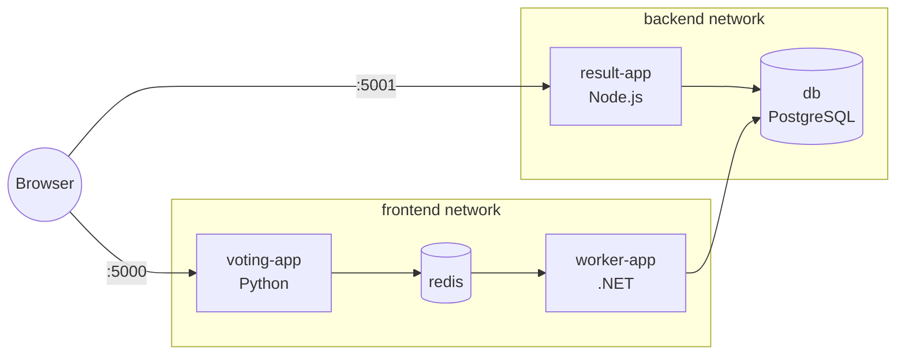

# Voting App – Microservices with Docker (no Compose)

Ironhack DevOps bootcamp lab: deploy a 5-service voting app using only `docker build`, `docker network` and `docker run` — no Docker Compose.

Source code: [Pokfinner/ironhack-project-1](https://github.com/Pokfinner/ironhack-project-1)

## Architecture



| Network  | Containers                       |
|----------|----------------------------------|
| frontend | voting-app, redis, worker-app    |
| backend  | db, result-app, worker-app       |

The worker is the only container on both networks — it moves votes from Redis to PostgreSQL.

## How to run

```bash
./build-push.sh   # build images and push to Docker Hub (hserindik/*)
./deploy.sh       # create networks and start containers
./cleanup.sh      # remove everything
```

- Vote: http://localhost:5000
- Result: http://localhost:5001

## Network isolation test

```bash
docker exec voting-app getent hosts db      # no result -> different network
docker exec worker-app getent hosts db      # resolves
docker exec worker-app getent hosts redis   # resolves
```

## What I learned

- **Container port vs. published port:** containers on the same network reach each other directly (`redis:6379`, `db:5432`). `-p host:container` is only needed for access from outside Docker (the browser).
- **Docker DNS:** on a user-defined network, the container name is the hostname. The app code expects `redis` and `db`, so the names must match.
- **Registries deduplicate layers by content digest**, not by image name (`Mounted from ...` on push).
- **Docker inside WSL:** when WSL shuts down, all containers stop. Without a restart policy they stay stopped.
- **Avoid `:latest` in real projects:** pin versions (e.g. `postgres:15-alpine`) for reproducible deployments.

## Possible improvements

- `--restart unless-stopped` restart policy
- Named volume for PostgreSQL data persistence
- Pinned image versions instead of `:latest`

## Screenshots

| Step | Screenshot |
|------|------------|
| Build |  |
| Push |  |
| Networks |  |
| Running containers |  |
| Isolation test |  |
| Vote |  |
| Result |  |
