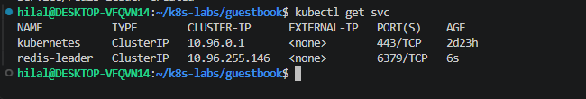
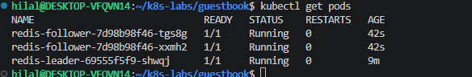
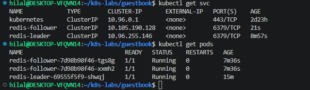
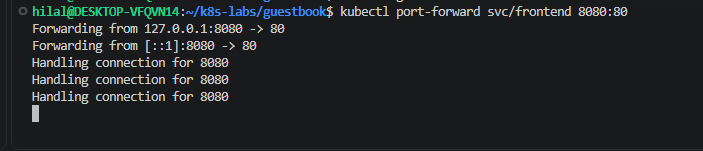
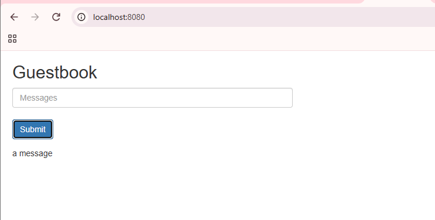
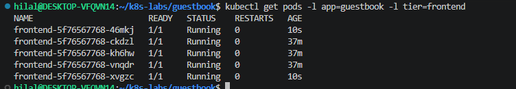
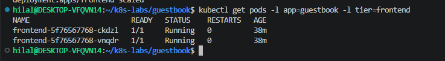
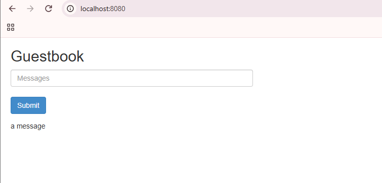

# Multi-Tier Guestbook App on Kubernetes

A PHP Guestbook frontend backed by Redis (one leader for writes, two followers
for reads), deployed on a local Minikube cluster.

```
Browser ──► frontend (PHP, 3 replicas)
               │ write                 │ read
               ▼                       ▼
         redis-leader (1)  ──sync──►  redis-follower (2)
```

## What I did

1. Deployed the Redis leader and exposed it with a ClusterIP Service
2. Deployed two Redis followers that replicate from the leader, plus their Service
3. Deployed the PHP frontend (3 replicas) and its ClusterIP Service
4. Accessed the app with `kubectl port-forward` and wrote a message
5. Scaled the frontend 3 → 5 → 2 and confirmed the message was still there

## Notes and learnings

- **Manifests stored locally:** the lab applies YAML files straight from
  `k8s.io`. I downloaded them into this folder first so they can be read and versioned.
- **Stateless vs. stateful:** frontend Pods hold no data, so scaling them does
  not lose messages. The data lives in Redis (without a PersistentVolume it
  would be lost if the leader Pod restarted).
- **Labels matter:** `kubectl logs deployment/redis-follower` showed the
  *leader's* logs, because the follower selector (`app: redis`) also matches the
  leader Pod. `kubectl logs -l role=follower` selects the right Pods.
- **Replication proof:** the leader's logs show both followers requesting and
  completing a full sync.
- **port-forward pins one Pod:** after scaling down, the tunnel broke because
  its Pod was deleted. Restarting `port-forward` fixed it.
- The lab text says to open `http://localhost`; with `8080:80` the correct URL
  is `http://localhost:8080`.

## Commands

```bash
kubectl apply -f redis-leader-deployment.yaml
kubectl apply -f redis-leader-service.yaml
kubectl apply -f redis-follower-deployment.yaml
kubectl apply -f redis-follower-service.yaml
kubectl apply -f frontend-deployment.yaml
kubectl apply -f frontend-service.yaml

kubectl port-forward svc/frontend 8080:80

kubectl scale deployment frontend --replicas=5
kubectl scale deployment frontend --replicas=2
```

## Screenshots

### Redis leader Service


### Redis followers running


### Backend Services and Pods


### port-forward to the frontend


### Guestbook in the browser


### Scaled to 5 frontend Pods


### Scaled down to 2 frontend Pods


### Message still there after scaling

