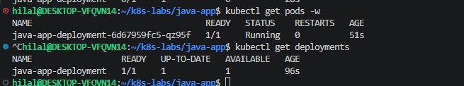
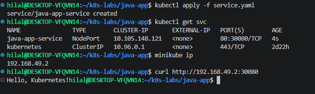
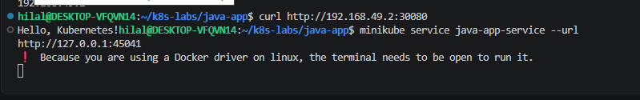
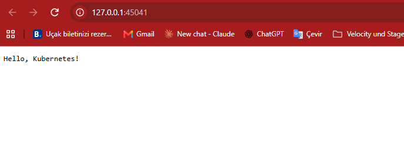

# Simple Java App on Kubernetes

A minimal Java HTTP server ("Hello, Kubernetes!") containerized with Docker
and deployed to a local Minikube cluster as a Deployment + NodePort Service.

## What I did

1. Wrote a small Java HTTP server listening on port 8080
2. Built a multi-stage Docker image (JDK for build, JRE for runtime)
3. Tested it locally with `docker run`, then pushed it to Docker Hub
4. Deployed it to Kubernetes and exposed it with a NodePort Service

> **Note:** The lab used `adoptopenjdk` images, which are deprecated.
> I used `eclipse-temurin` (the official successor) instead.

## Commands

```bash
docker build -t my-java-app:1.0 .
docker run -d -p 8080:8080 --name test-java-app my-java-app:1.0
curl http://localhost:8080

docker tag my-java-app:1.0 hserindik/my-java-app:1.0
docker push hserindik/my-java-app:1.0

kubectl apply -f deployment.yaml
kubectl apply -f service.yaml
curl http://$(minikube ip):30080
minikube service java-app-service --url
```

## Screenshots

### Local Docker test


### Deployment and Pod running


### Service and NodePort access


### Access via `minikube service`


