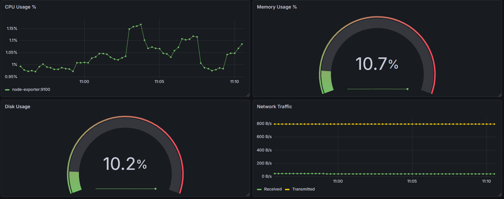
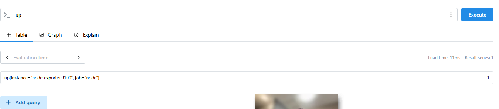

# Prometheus & Grafana Monitoring Stack

A monitoring stack built with Docker containers: **Node Exporter** exposes host metrics, **Prometheus** scrapes and stores them, and **Grafana** visualizes them on a dashboard.

## Architecture

```
Node Exporter (:9100)  <--scrape every 15s--  Prometheus (:9090)  <--query--  Grafana (:3000)
            \___________________ Docker network: monitoring ___________________/
```

All containers share a custom Docker network (`monitoring`), so they reach each other by container name (e.g. `prometheus:9090`) instead of changing private IPs.

## Setup

```bash
# Network and volumes
docker network create monitoring
docker volume create prometheus-data
docker volume create grafana-storage

# Node Exporter
docker run -d --name node-exporter --network monitoring -p 9100:9100 prom/node-exporter

# Prometheus (config from ./prometheus.yml)
mkdir ~/prometheus-config && cp prometheus.yml ~/prometheus-config/
docker run -d --name prometheus --network monitoring -p 9090:9090 \
  -v ~/prometheus-config:/etc/prometheus/ \
  -v prometheus-data:/prometheus \
  prom/prometheus

# Grafana
docker run -d --name grafana --network monitoring -p 3000:3000 \
  -v grafana-storage:/var/lib/grafana \
  grafana/grafana-oss
```

Then in Grafana (`http://localhost:3000`): add a Prometheus data source with URL `http://prometheus:9090`, and import `dashboard.json`.

## Dashboard: System Health Overview

| Panel | Type | PromQL |
|---|---|---|
| CPU Usage % | Time series | `100 - (avg by (instance) (rate(node_cpu_seconds_total{mode="idle"}[5m])) * 100)` |
| Memory Usage % | Gauge | `(node_memory_MemTotal_bytes - node_memory_MemAvailable_bytes) / node_memory_MemTotal_bytes * 100` |
| Disk Usage % | Gauge | `max(100 - (node_filesystem_avail_bytes{fstype="ext4"} / node_filesystem_size_bytes{fstype="ext4"} * 100))` |
| Network Traffic | Time series | `rate(node_network_receive_bytes_total{device="eth0"}[5m])` / `rate(node_network_transmit_bytes_total{device="eth0"}[5m])` |

## Notes & lessons learned

- **Disk metric:** `node_filesystem_usage_bytes` (from the lab text) does not exist in Node Exporter. Disk usage is calculated from `node_filesystem_size_bytes` and `node_filesystem_avail_bytes`.
- **Duplicate disk series:** Inside a container, Node Exporter sees bind-mounted files (`/etc/hosts`, `/etc/hostname`, `/etc/resolv.conf`) on the same disk, so `max()` reduces them to one value.
- **Container names vs. localhost:** Container names only resolve *inside* the Docker network. From the host terminal, use `localhost:9100`.
- **Environment:** Run on Docker in WSL (Windows). Node Exporter therefore measures the WSL Linux VM, not the Windows host.
- **Network traffic:** The steady ~800 B/s outbound traffic is Prometheus scraping Node Exporter's `/metrics` page every 15 seconds.

## Screenshots

**Dashboard**



**Prometheus target is up**


