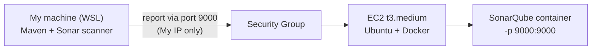

# SonarQube on AWS EC2 (self-hosted)

Self-hosted SonarQube running in Docker on an EC2 instance, used to scan the
[Spring PetClinic](https://github.com/spring-projects/spring-petclinic) Java app
from my local machine with the Maven scanner.

Ironhack DevOps & Cloud Computing bootcamp lab.

## Architecture



- The **scanner** runs where the code is (WSL): it analyses the code and sends a report.
- The **SonarQube server** (EC2) stores the report, applies the Quality Gate and shows the results.

## Steps

1. **EC2:** `t3.medium` (SonarQube needs ~4 GB RAM), Ubuntu, 20 GB disk.
   Security group: port 22 and 9000, source = My IP only.
   Docker is installed at first boot by [`user-data.sh`](user-data.sh).
2. **Start SonarQube:**
   ```bash
   docker run -d --name sonarqube \
     -e SONAR_ES_BOOTSTRAP_CHECKS_DISABLE=true \
     -p 9000:9000 sonarqube:latest
   ```
3. **UI:** `http://<EC2-Public-IP>:9000`, change the default admin password,
   create a local project and a project token.
4. **Scan PetClinic** (JDK 21 in WSL):
   ```bash
   export SONAR_TOKEN=$(cat ~/.sonar-token-ec2)
   ./mvnw clean verify org.sonarsource.scanner.maven:sonar-maven-plugin:sonar \
     -Dsonar.projectKey=spring-petclinic \
     -Dsonar.host.url=http://<EC2-Public-IP>:9000 \
     -Dsonar.token=$SONAR_TOKEN
   ```

## Results

<!-- add dashboard screenshot here -->


## Troubleshooting

| Problem | Cause | Fix |
|---|---|---|
| `Permission denied (publickey)` | An old key with the same name in `~/.ssh` | Remove the old key, copy the new one, `chmod 400` |
| Docker missing after launch | AMI was Amazon Linux, `user-data.sh` uses `apt` | Relaunched with Ubuntu (Amazon Linux uses `dnf`, user `ec2-user`) |
| `docker ps`: permission denied | Docker group applies only after a new login | Log out and in again |
| `No plugin found for prefix 'sonar'` | Short `sonar:sonar` prefix no longer resolves | Use the full plugin name `org.sonarsource.scanner.maven:sonar-maven-plugin:sonar` |
| `401 Unauthorized` | A leading space in the token file | `sed -i 's/ //g' ~/.sonar-token-ec2` |

The lab text also uses `-Dsonar.login`, which is deprecated; `-Dsonar.token` is the current parameter.

## Notes: self-hosted vs. SonarQube Cloud in CI

To scan from GitHub Actions, GitHub-hosted runners would need to reach port 9000,
but their IPs change on every run, so the server would have to be open to the internet.

- **Self-hosted runner:** the runner sits in the same network (VPC) as SonarQube and
  connects *out* to GitHub to fetch jobs. Port 9000 stays internal.
- **SonarQube Cloud:** no server to run or expose. I used this in
  [Project 2](https://github.com/huluc/voting-app-eks), where the Quality Gate blocks the deploy.

## Cleanup

EC2 instance terminated, token revoked, key pair deleted.
