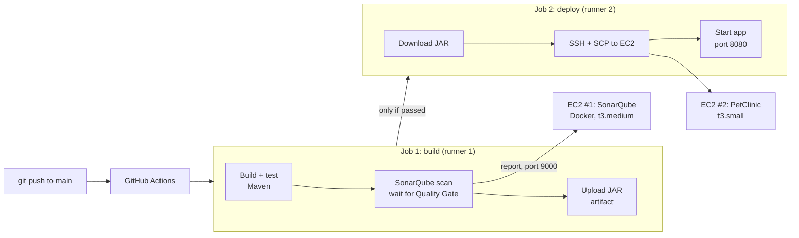

# SonarQube on AWS EC2 + CI/CD for Spring PetClinic

Two connected Ironhack DevOps & Cloud Computing bootcamp labs:

1. **Self-hosted SonarQube** in Docker on EC2, scanning
   [Spring PetClinic](https://github.com/spring-projects/spring-petclinic) from my machine.
2. **CI/CD pipeline** with GitHub Actions: build, test, SonarQube Quality Gate,
   and deploy of the JAR to a second EC2 instance.

Pipeline code: [huluc/spring-petclinic → `.github/workflows/ci-cd.yml`](https://github.com/huluc/spring-petclinic/blob/main/.github/workflows/ci-cd.yml)

Screenshots: [`screenshots/`](screenshots/)


## Architecture



| Component | Where | Role |
|---|---|---|
| Scanner | Where the code is (WSL in Part 1, GitHub runner in Part 2) | Analyses the code, sends a report |
| SonarQube server | EC2 #1 | Stores reports, applies the Quality Gate, shows results |
| App server | EC2 #2 | Runs the PetClinic JAR |

## Part 1: Self-hosted SonarQube + local scan

1. **EC2:** `t3.medium` (SonarQube needs ~4 GB RAM), Ubuntu, 20 GB disk.
   Docker installed at first boot by [`user-data.sh`](user-data.sh).
2. **Start SonarQube:**
   ```bash
   docker run -d --name sonarqube \
     -e SONAR_ES_BOOTSTRAP_CHECKS_DISABLE=true \
     -p 9000:9000 sonarqube:latest
   ```
3. **Scan from WSL** (JDK 21):
   ```bash
   export SONAR_TOKEN=$(cat ~/.sonar-token-ec2)
   ./mvnw clean verify org.sonarsource.scanner.maven:sonar-maven-plugin:sonar \
     -Dsonar.projectKey=spring-petclinic \
     -Dsonar.host.url=http://<SONARQUBE-IP>:9000 \
     -Dsonar.token=$SONAR_TOKEN
   ```


**Result:** Quality Gate **Passed**, 90.8% coverage, 0% duplication.
The gate passes despite existing issues because the default *Sonar way* gate only checks **new code**.

## Part 2: CI/CD with GitHub Actions

Forked PetClinic, added four repository secrets
(`SONAR_HOST_URL`, `SONAR_TOKEN`, `EC2_HOST`, `EC2_PRIVATE_KEY`) and the workflow.

| Trigger | What runs |
|---|---|
| Push to `main` | build → scan → deploy |
| Pull request | build → scan only (no deploy) |


### What I changed compared to the lab's workflow

| Change | Why |
|---|---|
| `-Dsonar.qualitygate.wait=true` | The lab's version deploys even if the Quality Gate fails. Now a failed gate stops the deploy |
| One Maven step instead of two | Tests ran twice in the original |
| `distribution: temurin` | `adopt` (AdoptOpenJDK) is retired |
| Current action versions | checkout v7, setup-java v6, upload-artifact v7, download-artifact v8 |
| `fetch-depth: 0` | SonarQube needs Git history to detect new code |
| Deploy only on `push` | Pull requests should never deploy |
| Separate SSH key for the app server | The SonarQube server's key never goes to GitHub |
| `< /dev/null` on the start command | Keeps the SSH step from hanging |

## Troubleshooting

| Problem | Cause | Fix |
|---|---|---|
| `Permission denied (publickey)` | An old key with the same name in `~/.ssh` | Remove the old key, copy the new one, `chmod 400` |
| Docker missing after launch | AMI was Amazon Linux, `user-data.sh` uses `apt` | Relaunched with Ubuntu (Amazon Linux uses `dnf`, user `ec2-user`) |
| `docker ps`: permission denied | Docker group applies only after a new login | Log out and in again |
| `No plugin found for prefix 'sonar'` | Short `sonar:sonar` prefix no longer resolves | Full name: `org.sonarsource.scanner.maven:sonar-maven-plugin:sonar` |
| `401 Unauthorized` | A leading space in the token file | `sed -i 's/ //g' ~/.sonar-token-ec2` |
| Wrong project key in the lab's workflow | A project token only works for its own project | Used the existing key `spring-petclinic` |

The lab also uses `-Dsonar.login`, which is deprecated; `-Dsonar.token` is the current parameter.

## Security notes (lab vs. production)

GitHub-hosted runners get a different IP on every run, so for this lab
**port 9000 (SonarQube) and port 22 (app server) were open to `0.0.0.0/0`**,
only for the duration of the lab.

In production this would be avoided:

- **Self-hosted runner** in the same VPC as SonarQube and the app server.
  The runner connects *out* to GitHub to fetch jobs, so no inbound ports are opened to the internet.
- **SonarQube Cloud** instead of a self-hosted server. I used this in
  [Project 2](https://github.com/huluc/voting-app-eks), where the Quality Gate blocks the deploy.
- **PostgreSQL** for SonarQube instead of the embedded database
  (SonarQube shows a warning: the embedded DB is for evaluation only).
- **systemd service** instead of `nohup`, so the app restarts after a crash or reboot.

## Cleanup

Both EC2 instances terminated, SonarQube token revoked, both key pairs deleted.
